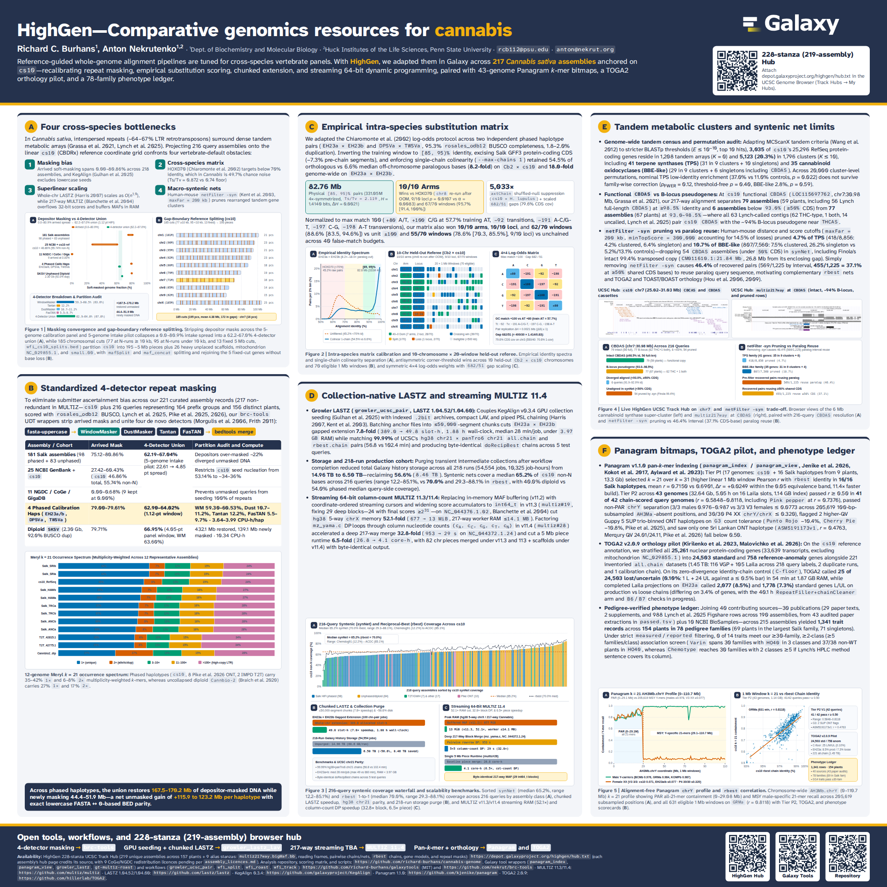

# HighGen — CSHL Biological Data Science 2026 Poster

**Title:** HighGen—Comparative genomics resources for cannabis  
**Authors:** Richard C. Burhans, Anton Nekrutenko (Penn State University)  
**Conference:** CSHL Biological Data Science (November 4–7, 2026)  
**Dimensions:** 44 × 44 in (`@page { size: 44in 44in; margin: 0; }`, fits 4 × 4 ft CSHL poster boards)

## Files

- `template.html` — 44 × 44 in HTML/CSS poster source (follows `writing` repository style rules: zero semicolons in prose or SVG labels, closed em-dashes, Okabe-Ito colorblind-safe figures).
- `generate_poster_figures.py` — Generates the five data-dense SVG figures directly from primary TSV/BED files in `cannabis-genome`:
  - `figures/figure1_architecture.svg` — Depositor soft-masking ascertainment (`0.0–80.9%`) vs. 4-detector union convergence (`62.2–67.0%`) across the 218-assembly intake, paired with the 185-cut `cs10` gap-boundary reference split map (`wfi_cs10_splits.bed`, 195 chromosomal ~5 Mb pieces, 0 genes cut).
  - `figures/kmer_bands_k21.svg` — Empirical Meryl $k = 21$ multiplicity-weighted occurrence spectra across 12 representative assemblies (`cs10`, 8 Pike et al. 2026 ONT haplotypes, 2 IMPD T2T haplotypes, and diploid `Cannbio-2`).
  - `figures/figure2_matrix_calibration.svg` — Single-chain colinearity `[85, 95)%` identity spectrum (`82.76 Mb` physical / `331.05M` 4×-symmetrized pairs), all-10-chromosome × 20-window pre-registered held-out referee map (`Cb2 × cs10`, `10/10` arms and `67/70` 1 Mb windows won vs HOXD70), and symmetric `4×4` log-odds matrix (`+80/+100` matches, `682/51` gap scaling).
  - `figures/figure3_scalability_benchmarks.svg` — 216-query syntenic (`synNet`, median `65.2%`) and reciprocal-best (`rbest`, median `70.0%`) coverage waterfall across `cs10` (`query_coverage.tsv`), chunked `≤50k`-segment LASTZ speedup (`7.8×`) and `-56.6%` collection purge, and streaming 64-bit column-count MULTIZ 11.4 benchmarks (`52.1×` RAM reduction, `32.8×` block merge speedup, `6.5×` single-piece speedup).
  - `figures/chr7_25.022-31.033Mb_cbs_overview.png` & `figures/multiz_cbdas.png` — Live HighGen 228-stanza (219-assembly) UCSC Genome Browser Track Hub screenshots across the 6 Mb `cs10` chromosome 7 cannabinoid synthase super-cluster (`CBCAS` and `CBDAS` cassettes) and the `multiz217way` alignment track at functional `CBDAS` (`LOC115697762`).
  - `figures/figure4_tandem_clusters.svg` — 216-query `CBDAS` stratification (`79` intact `≥98.5%`, `77` B-locus pseudogenes `93.0–98.5%`, `6` aligned `<93.0%`, `54` `<50%` CDS pruned in `synNet`) and `netFilter -syn` pruning vs. `46.4%` pre-filter paralog interval reuse (`37.1%` at `≥50%` shared CDS).
  - `figures/figure5_panagram_kmer.svg` — Chromosome-wide `AH3Mb.chrY` (`0–110.7 Mb`) Panagram $k = 21$ pseudoautosomal (`0–29.08 Mb`) vs. male-specific Y (`205,619` Y-mers, males `0.976–0.987` vs. V3 females `≤0.077`) profile, 1 Mb window `rbest` chain correlation scatter on `GRMa` (`631` windows, `r = 0.8118`), and Tier P2 (`41/42` passing), TOGA2 v2.0.9 pilot, and 1,341-record phenotype ledger scorecards.
- `build.py` — Renders `template.html` to `cannabis-poster.pdf` (44 × 44 in) and `poster-preview.png` via headless Chromium (`uv run --with playwright python build.py`).
- `cannabis-poster.pdf` & `poster-preview.png` — Rendered 44 × 44 in print PDF and thumbnail preview.
- `galaxy-logo.svg`, `qr-hub.svg`, `qr-tools.svg`, `qr-repo.svg` — Vector logo and QR codes.

